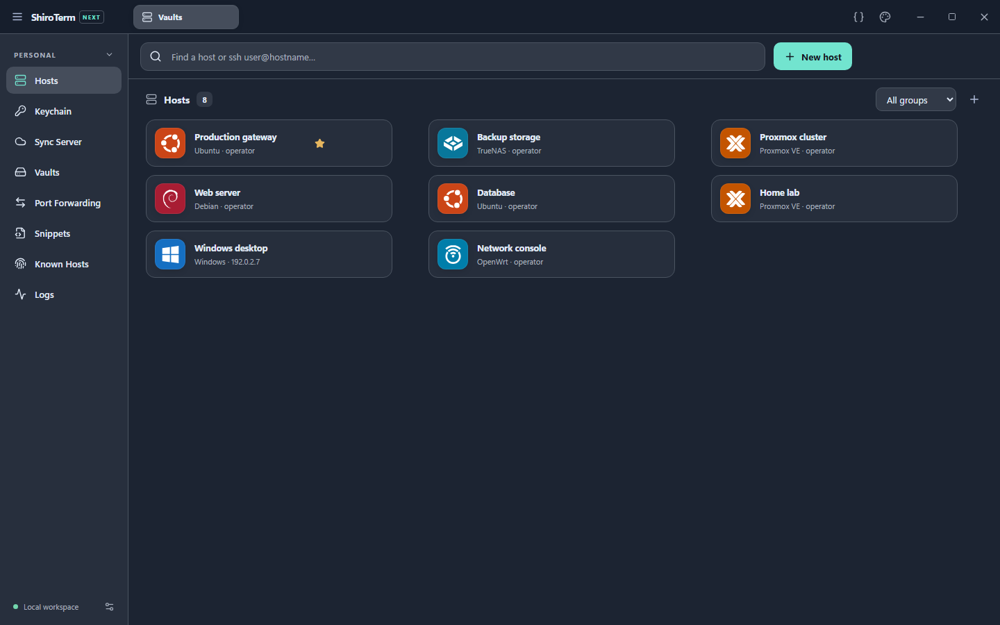
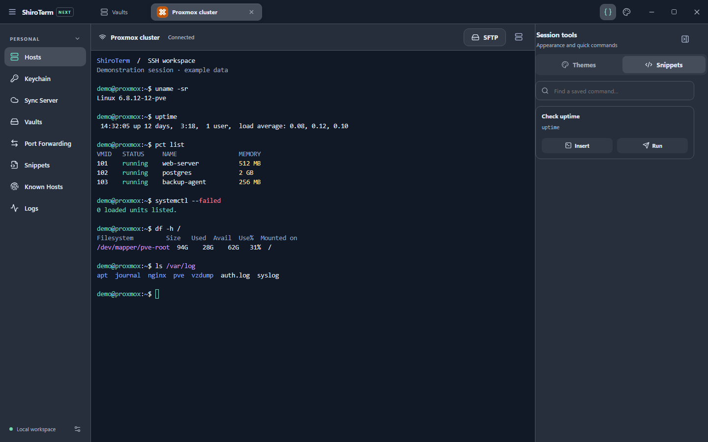
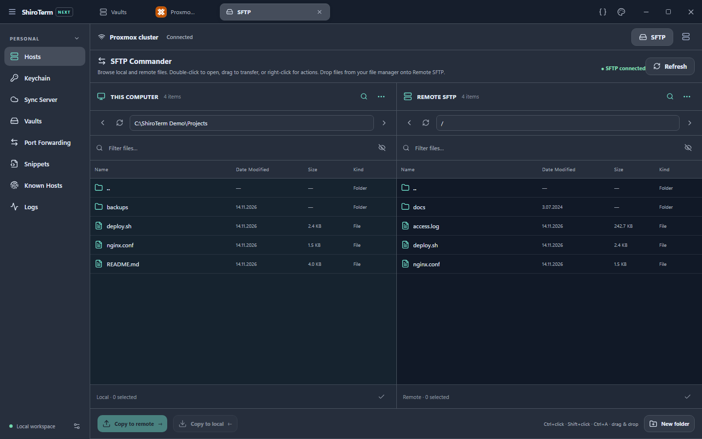
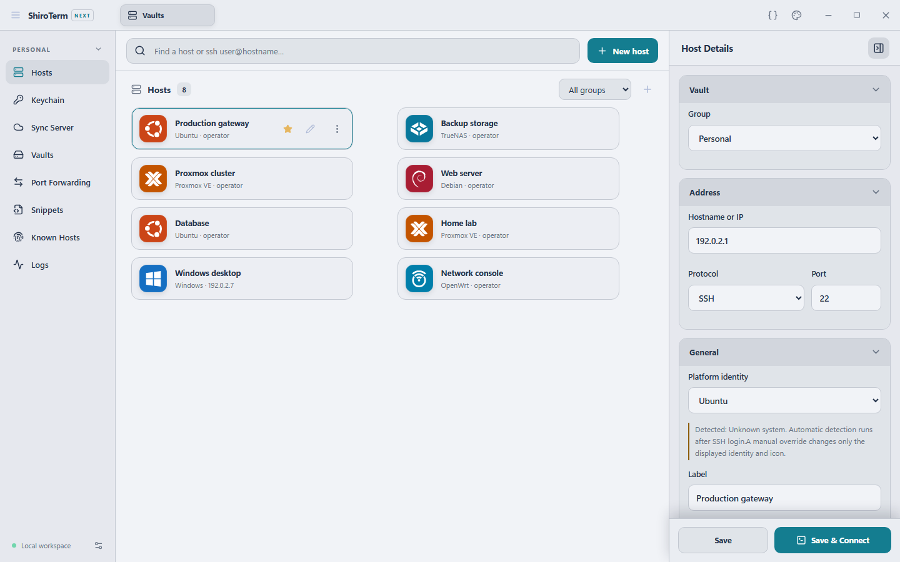

# ShiroTerm

SSH terminal and SFTP file manager for **Windows and Linux**. Built with Electron,
React, TypeScript, xterm.js and ssh2. Free and open source under the MIT license.

**[Download the latest release](https://github.com/Richailo/ShiroTerm/releases/latest)**

ShiroTerm works without an account or a synchronization server. Your local hosts,
credentials, snippets and SSH sessions are available immediately.

## Screenshots

The screenshots below use demonstration hosts, files and terminal output.

**Host workspace**



**SSH terminal and snippets**



**SFTP file manager**



**Light theme and host settings**



## Download and run

| System | Package | Start |
| --- | --- | --- |
| Windows 10/11, x64 | `ShiroTerm-*-win32-x64.zip` | Extract everything and run `ShiroTerm.exe` |
| Linux desktop, x64 | `ShiroTerm-*-linux-x64.tar.gz` | Extract everything and run `./ShiroTerm` |

Keep the full extracted directory together. Node.js is bundled; users do not
need to install it. Portable refers to the application bundle: user data stays
in the OS user profile and is not stored beside the executable. These first
public packages are unsigned. Compare downloaded files with `SHA256SUMS.txt`.

Linux builds are tested on Ubuntu 22.04 with Xvfb. A graphical desktop and
Electron's system libraries are required. On Debian/Ubuntu, install missing
libraries with your package manager (`libgtk-3-0`, `libnss3`, `libgbm1`,
`libasound2`, `libsecret-1-0`; newer distributions may use `t64` package names).
Use an unlocked GNOME Keyring or KWallet to save passwords and remember server
sessions. If no secure keyring is available, connections still work with
one-time credentials; ShiroTerm refuses to store secrets using Electron's
`basic_text` fallback. Run as your normal desktop user.

The Linux archive contains a sample `shiroterm.desktop` launcher. If desired,
copy the application to a permanent location, update the launcher's `Exec` and
`Icon` to absolute paths, and put it in `~/.local/share/applications/`.
Linux environments that restrict user namespaces may need an administrator to
configure Electron sandbox support for the installed application location.

## Features

- SSH terminal with host-key confirmation, password or private-key authentication,
  encrypted-key passphrases and keyboard-interactive authentication.
- SFTP with local and remote panes, uploads, downloads, recursive directory
  transfers, drag and drop, rename, folder creation and confirmed deletion.
- Remote editing through an external editor with a confirmed upload and conflict
  detection before saving changed files.
- SSH jump hosts, local TCP port forwarding, keepalive and bounded reconnection.
- Saved hosts, folders, favorites, search, credential keychain and snippets.
- Tabs with drag reordering, keyboard navigation, context menus and retained
  terminal state; six themes with separate workspace and host preferences.
- Host OS/appliance detection, known-host management and a redacted activity log.
- RDP through Windows Remote Desktop or Remmina on Linux. Install Remmina and its
  RDP plugin separately; the external client handles login and certificates.
- Basic interactive Telnet with an explicit warning about unencrypted traffic.
- Optional encrypted profile synchronization and Vaultwarden integration through
  a compatible, separately deployed ShiroTerm Server.

## Optional synchronization: sign in once

Open **Sync Server**, enter your own HTTPS server address and authorize the
device in your browser. The device token is encrypted using your OS account's
secret store. At the next launch, ShiroTerm restores the session automatically
in the background and retries every minute after temporary outages. There is
no need to sign in on every launch. Expired or revoked device authorization
requires a new browser sign-in.

Local hosts are loaded before the server is contacted. An unavailable server
never blocks the application. **No server is preconfigured**, and the desktop
release does not include or host a synchronization server. Cloud-only Vaultwarden
credentials require that server to be reachable.

The independent passphrase used to decrypt synchronized profile backups is kept
only in memory and must be entered again when unlocking those backups. It is
separate from remembered account login. Host metadata and snapshots can sync;
local encrypted passwords and private keys are not uploaded as part of profiles.

HTTPS certificates are verified with the normal Node.js trust roots. For a
private deployment, set `SHIROTERM_SYNC_CA` to the absolute path of a trusted
CA PEM file before starting the application. Private addresses, trust roots,
profile data and credentials are not bundled or published.

## Keyboard shortcuts

| Shortcut | Action |
| --- | --- |
| Ctrl+Tab / Ctrl+Shift+Tab | Next / previous tab |
| Ctrl+1 ... Ctrl+9 | Select a numbered tab |
| Ctrl+W outside text input | Close the active session |
| Ctrl+Shift+V in the terminal | Paste, with multiline confirmation |
| F2 on a selected host | Edit host |
| Shift+F10 on a focused tab | Open tab menu |
| Middle-click on a tab | Close tab |

## Build from source

Use Node.js 24 LTS and npm (Node.js 22.12 or newer is supported).

```sh
npm ci
npm run dev
```

```sh
npm run check          # unit/integration tests, TypeScript and production build
npm run test:native    # real Electron + loopback SSH and SFTP fixture
npm run package        # package the already-built app for the current OS
npm run test:packaged  # run the same test against the packaged executable
npm run archive        # create a versioned native ZIP or tar.gz
```

On a Linux build machine, run GUI checks under `xvfb-run -a` when no display is
available. `npm run test:ui` runs additional browser regressions; use a local
Chrome installation or set `SHIROTERM_CHROMIUM` to a Chromium executable.

`npm run package:win` and `npm run package:linux` also rebuild the renderer.
For an arm64 source package, run `node tools/package.cjs linux arm64` on a matching
build environment. Native dependencies should be built on the target OS and
architecture. Public release downloads currently cover x64.

GitHub Actions tests and packages on Windows and Ubuntu. Tagged `v*` builds
publish archives and SHA-256 checksums only after both platforms pass, including
real Electron SSH/SFTP tests of the packaged application.

## Data and compatibility

The existing `ShiroTerm Next` OS user-data directory is retained so upgrades
keep local profiles: `%APPDATA%/ShiroTerm Next` on Windows and
`$XDG_CONFIG_HOME/ShiroTerm Next` (normally `~/.config/ShiroTerm Next`) on Linux.
Windows can import non-secret host/folder metadata from the classic edition.
Legacy encrypted passwords must be re-entered. The classic profile is not changed.
Do not copy a user profile between operating systems expecting OS-encrypted
passwords or device tokens to decrypt there.

This release supports the features listed above. Local shells, serial ports,
embedded RDP, multiple jump-host hops, remote/dynamic port forwarding and saved
workspace restoration are not implemented. SFTP directory deletion is limited
to empty directories. The optional server is a separate project, not included
in this repository. See [SECURITY.md](SECURITY.md) for security and privacy details.

## Contributing

Bug reports and focused pull requests are welcome. Include your OS version,
ShiroTerm version and steps to reproduce. Use local test fixtures and remove
credentials, private keys and connection metadata from attachments.

## License

[MIT](LICENSE). See [THIRD_PARTY_NOTICES.md](THIRD_PARTY_NOTICES.md) for dependency
licenses and trademark acknowledgments.
