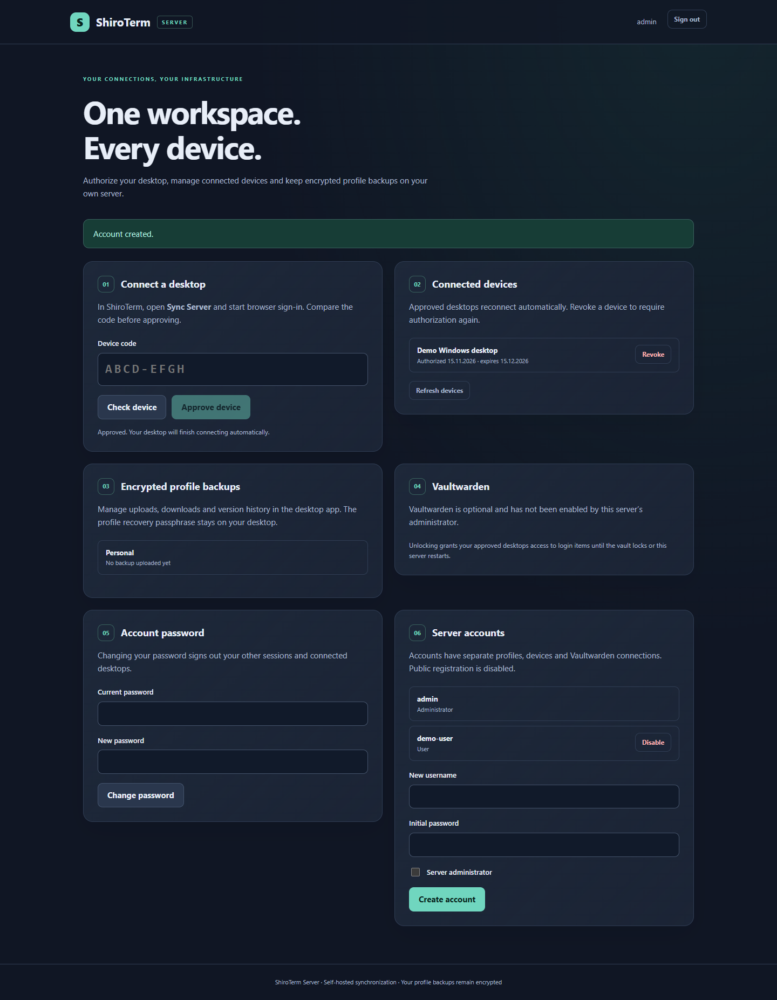

# ShiroTerm Server

A self-hosted synchronization server for the ShiroTerm desktop app. Includes a
browser console, device authorization, remembered sessions, encrypted profile
backups, version history, private vaults and optional Vaultwarden integration.
The application runs as a non-root Linux container on amd64 and arm64.

<details>
<summary>Preview the browser console (demonstration accounts)</summary>



</details>

## Deploy with Docker Compose

Requirements: Docker Engine with Compose v2, a domain pointing to your server,
and inbound TCP ports 80 and 443 (UDP 443 is optional). Run these commands from
a private directory on your deployment host:

```sh
git clone https://github.com/Richailo/ShiroTerm.git
cd ShiroTerm/server
docker run --rm --user "$(id -u):$(id -g)" \
  -v "$PWD:/work" -w /work node:24-bookworm-slim \
  node setup.cjs sync.example.com
docker compose up -d
```

Replace `sync.example.com` with your domain. Alternatively, if Node.js 24 is
installed, run `node setup.cjs sync.example.com` directly. Setup creates a private
`.env`, a private `secrets/` directory and a random initial administrator password.
It refuses to overwrite existing configuration. No default password is shipped.

Open `https://sync.example.com/console`. Sign in as `admin` using the password in
`secrets/admin_password`. Change the account password in the console after the
first sign-in. The bootstrap file is used only when creating a fresh database;
changing it later does not reset an existing account.

Caddy obtains and renews HTTPS certificates and redirects HTTP to HTTPS. The
application port is accessible only inside the Compose network. Caddy needs the
domain's DNS and firewall/NAT rules to reach this host. See the
[Caddy HTTPS documentation](https://caddyserver.com/docs/automatic-https).

Prebuilt image: `ghcr.io/richailo/shiroterm-server:0.1.0`.
To build from the checked-out source instead:

```sh
docker compose up -d --build
```

The image contains Node.js 24 and Bitwarden CLI 2026.10.1. Dockerfile build context
excludes configuration, secrets, databases, test fixtures and desktop assets.

## Connect ShiroTerm

1. Open **Sync Server** in the desktop app and enter your server's HTTPS origin.
2. Start browser sign-in. Sign in to the console if needed and compare the code.
3. Select **Approve device**, then return to ShiroTerm.
4. Open **Vaults**, enter a separate recovery passphrase and explicitly upload or
   download profiles before enabling automatic synchronization.

The desktop remembers the device token using the OS credential store and
reconnects in the background on subsequent launches. Server outages do not block
local desktop use. Device authorization expires after 30 days by default, or
immediately when revoked. The recovery passphrase is kept only on the desktop
and is not remembered across desktop restarts.

The server stores opaque AES-256-GCM envelopes produced by the existing desktop
client. It cannot decrypt profile backups. SSH passwords, private keys and
key passphrases are excluded by the desktop's profile exporter. Uploads use
optimistic revision checks; concurrent writes cannot silently overwrite each
other. Up to 100 versions are retained per vault by default.

## Accounts and devices

The console lets administrators create, disable and re-enable accounts.
Registration is closed. Every user has separate profiles, private vaults,
devices and Vaultwarden state; the Personal vault is private to its account.
Shared/team vault membership is not part of this release.

Users can approve or revoke their devices and change their account password.
Password changes revoke other browser sessions, all desktop tokens and pending
approvals for that account. Disabling an account also revokes its access.

Device tokens are random 384-bit values; only their SHA-256 hashes are stored
in SQLite. Account passwords use salted scrypt. Browser cookies are HttpOnly,
Secure and SameSite=Strict; browser mutations require an origin check and CSRF
token. Pairing codes expire after 10 minutes and can be consumed only once.

## Optional Vaultwarden

Set `VAULTWARDEN_URL=https://vault.example.com` in `.env`, then recreate the
server container:

```sh
docker compose up -d
```

Sign in to the ShiroTerm console, then connect Vaultwarden using your Vaultwarden
email and master password. Authenticator (TOTP) two-factor codes are supported.
SSO, WebAuthn and organization item editing are not supported by this adapter.
New-device verification rules on your Vaultwarden deployment may require an
administrator to allow the CLI login flow.

Each ShiroTerm user has a separate encrypted Bitwarden CLI cache. Master
passwords are passed to the CLI through a child-process environment; decrypted
session keys remain only in server memory. Unlocks last 60 minutes by default,
and are lost on restart. A TOTP code is used only for the login attempt. New and
updated item payloads are passed through stdin rather than process arguments.

Approved desktops can list login metadata, retrieve passwords for authentication
and create/update personal login items. Updates check the expected revision and
preserve existing item metadata. Locking the vault affects all devices belonging
to that ShiroTerm account. Disabled Vaultwarden does not affect profile sync.

This optional feature requires trusting the ShiroTerm Server operator with
access to an unlocked Vaultwarden session. Use it only on your own trusted server.
The adapter is tested with an isolated CLI contract fixture; validate your own
Vaultwarden version, TLS trust and authentication policies before using real data.

## Configuration

| Setting | Default | Meaning |
| --- | --- | --- |
| `PUBLIC_URL` | required | External HTTPS origin, no path or credentials |
| `SHIROTERM_DOMAIN` | required by Compose | Domain served by Caddy |
| `ADMIN_USER` | `admin` | Initial administrator username |
| `ADMIN_PASSWORD_FILE` | `/run/secrets/admin_password` in Compose | First-start password file |
| `DATA_DIR` | `/data` | SQLite database and encrypted CLI caches |
| `DEVICE_SESSION_DAYS` | `30` | Remembered desktop session lifetime, 1–365 days |
| `BROWSER_SESSION_HOURS` | `12` | Browser session lifetime, 1–48 hours |
| `HISTORY_LIMIT` | `100` | Retained encrypted versions per vault, 2–1000 |
| `VAULTWARDEN_URL` | empty | Fixed administrator-selected HTTPS origin |
| `VAULT_UNLOCK_MINUTES` | `60` | In-memory unlock lifetime, 5–1440 minutes |
| `PORT` | `8080` | Internal application HTTP port |
| `ALLOW_HTTP` | `false` | Explicit development-only HTTP opt-in |

`compose.yml` exposes the common settings. Add any optional settings above under
the server's `environment` if needed. Body size is capped at 1,900,000 bytes;
decoded encrypted snapshot data is capped at 1,400,000 bytes. A user can have up
to 100 profile vaults and 100 active sessions. There is one server process per
database; run one replica with its persistent volume. Do not share this SQLite
database across multiple hosts or network filesystems.

For private-LAN certificates, configure Caddy's `tls internal` or mount a trusted
certificate/key. In the desktop, use **Sync Server → Certyfikat HTTPS** to import
the trusted public CA/certificate, or install the CA in your operating system's
trust store. The legacy `SHIROTERM_SYNC_CA` PEM option is also supported. Never disable
certificate verification. Keep private keys and local configuration out of Git.

## Operations and backups

```sh
docker compose ps
docker compose logs --tail 100 server
docker compose pull
docker compose up -d
```

Use a version tag or image digest for controlled upgrades. Keep the database and
configuration backed up before upgrades. A consistent live SQLite backup can be
created without stopping the server:

```sh
mkdir -p backups
docker compose exec -T server node admin.cjs backup /data/backup.sqlite
docker compose cp server:/data/backup.sqlite ./backups/shiroterm.sqlite
```

Choose a new backup filename on later runs; the helper never overwrites a file.
Store backups outside the Git checkout and protect them like account data.
Also retain your private `.env` and bootstrap/recovery files securely. Vaultwarden
master passwords and unlocked session keys are intentionally absent from backups.

To restore, stop the server first and replace `/data/shiroterm.sqlite` with your
consistent backup, preserving ownership by UID/GID 1000. Do not copy a live raw
SQLite file without its WAL. Before accepting connections after a restore, run
`docker compose run --rm server node admin.cjs revoke-all` to discard restored
sessions and pending approvals. Start the server and authorize desktops again.
`docker compose down` preserves volumes; `docker compose down -v` deletes them.

To recover an administrator password, put a new password (at least 12 characters)
in a private local file, then pass it through stdin:

```sh
docker compose exec -T server node admin.cjs reset-password admin < /private/new-password
docker compose restart server
```

This re-enables that account and revokes its sessions. Restart also locks all
in-memory Vaultwarden sessions. The password is never passed as a command argument.

## Development and verification

The server itself has no npm runtime dependencies; it uses Node.js 24 built-ins
and SQLite. The separately installed Bitwarden CLI is used only by Vaultwarden.

```sh
cd server
npm test
```

Tests cover HTTPS interoperability with the actual desktop client, device
pairing and remembered login, revocation, account isolation, optimistic writes,
merge conflicts, history retention, database restart, live backups, administrator
recovery, request limits, CSRF and the Vaultwarden CLI boundary. Test TLS keys are
generated in temporary directories and are never committed.

After installing the desktop development dependencies, run
`node server/tests/portal-smoke.cjs` from the repository root to check the browser console
with local Chrome, including phone-width layout. Set `SHIROTERM_CHROMIUM` for a
different Chromium executable.

The **Sync server container** workflow tests the server and, for `server-v*` tags,
builds a non-root, read-only container, checks real HTTP sync and restart
persistence, verifies the bundled CLI, and publishes amd64/arm64 images. No live
infrastructure, credentials or external Vaultwarden account is used in CI.

## API compatibility

| Route | Purpose |
| --- | --- |
| `GET /healthz` | Container health and server version |
| `GET /console` | Browser sign-in and management console |
| `POST /v1/device/start` | Create expiring code and polling secret |
| `POST /v1/device/poll` | Consume an approved request for a device token |
| `POST /v1/auth/login`, `/v1/auth/logout` | Legacy credential login / token revocation |
| `GET, PUT /v1/snapshot` | Personal encrypted profile snapshot |
| `GET /v1/history`, `/v1/history/:revision` | Retained version metadata / envelope |
| `GET, POST /v1/profile-vaults` | List / create account-private vaults |
| `/v1/profile-vaults/:id/snapshot`, `/history` | Same versioned APIs scoped to a vault |
| `/v1/vault/status`, `/items`, `/sync`, `/disconnect` | Optional Vaultwarden session and metadata |
| `/v1/vault/password`, `/item/create`, `/item/update` | Authorized login-secret operations |

Desktop requests use `Authorization: Bearer <token>`. Snapshot writes require
`{expected_revision, blob}` and return a new revision; stale revisions receive
HTTP 409. Browser-only management endpoints require the browser session and CSRF
token, and never return desktop polling secrets or raw saved device tokens.

ShiroTerm Server is MIT licensed. The container also redistributes the unmodified
Bitwarden CLI, which retains its own notices and license files. Upstream CLI
source for the pinned release is available at
[Bitwarden clients, cli-v2026.10.1](https://github.com/bitwarden/clients/tree/cli-v2026.10.1).
